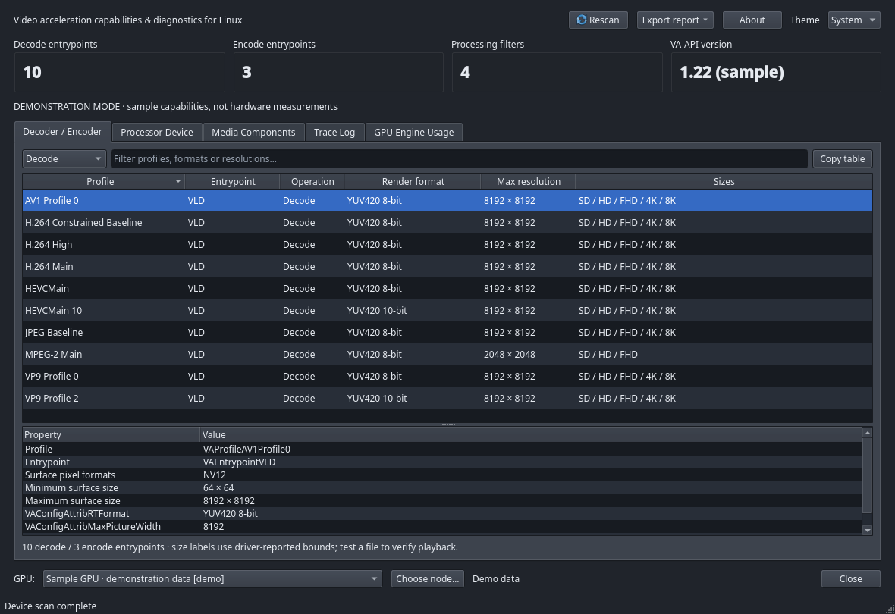

# VAAPI Checker

Native Linux GUI for inspecting hardware video acceleration. Built with **C++20 + Qt6 Widgets**, it calls **libva / libva-drm directly** through CMake, with no web server, browser engine or JavaScript runtime. Device scans and statistics collection run in the background, while FFmpeg runs through an asynchronous `QProcess`.



*Decoder / Encoder tab in `--demo` mode — sample capabilities, labelled DEMONSTRATION MODE.*

## Highlights

- Capabilities come from the **driver loaded on the machine**, queried through DRM render nodes (`/dev/dri/renderD*`) instead of a hardcoded GPU table
- Covers decode, encode and video processing, including config attributes, surface formats and driver-reported resolution bounds
- Runs a real VAAPI decode of a video file and shows its libva trace
- Reads per-process GPU engine usage from DRM fdinfo without running as root
- Exports JSON/text reports even when there is no GPU or display server

## Features

| Tab | What it does |
| --- | --- |
| Decoder / Encoder | Select a GPU and inspect VAProfile / VAEntrypoint, decode/encode operations, render formats, surface FOURCCs, min/max resolution and config attributes; search and copy the table |
| Processor Device | Inspect the video processing pipeline, input/output color standards, pixel formats, rotation/mirroring/blending flags and filter capabilities, including deinterlacing, color balance and HDR when the driver supports them |
| Media Components | Inspect the installed FFmpeg build, compiled hardware APIs and video decoders/encoders; read component details, probe file metadata with ffprobe and run a VAAPI decode test |
| Trace Log | Show libva calls made by the app, FFmpeg diagnostics and the test's libva trace; search, open trace files and save displayed rows as TSV |
| GPU Engine Usage | Read per-process engine utilization from DRM fdinfo; adjust the sampling interval, start/stop and save a snapshot |

Export the capability report as JSON or text, or copy it to the clipboard, from **Export report** — this works for both successful scans and error cases.

## Requirements

A Linux system with a C++20 compiler, CMake ≥ 3.21, Qt6 ≥ 6.4 (Widgets, Concurrent, DBus) and libva/libva-drm ≥ 1.12. Qt6 Test is only needed when building the tests. `ffmpeg` and `ffprobe` are optional runtime dependencies for the Media Components tab; capability inspection does not need them.

Fedora:

```bash
sudo dnf install gcc-c++ cmake ninja-build qt6-qtbase-devel libva-devel
```

Ubuntu/Debian with Qt6 ≥ 6.4:

```bash
sudo apt install build-essential cmake ninja-build qt6-base-dev libva-dev
```

## Build and run

```bash
cmake -S . -B build -G Ninja -DCMAKE_BUILD_TYPE=Release
cmake --build build -j
./build/vaapi-checker
```

If the compiler is wrapped by ccache and its cache directory is unwritable, configure with `-DCMAKE_CXX_COMPILER=/usr/bin/g++` or set `CCACHE_DISABLE=1` for the build command.

Install the executable, desktop entry and icon into your user account:

```bash
cmake --install build --prefix "$HOME/.local"
```

Keep `$HOME/.local/bin` in `PATH` when launching from a desktop launcher.

## AppImage for Debian 13 / Ubuntu 24.04

Use Podman or Docker to build against the Ubuntu 24.04 baseline and run the same AppImage on both distributions:

```bash
./scripts/build-appimage.sh
```

Output, including SHA256, build information and compatibility logs, is written to `dist/`. Qt6 is bundled while the GPU driver and libva come from the host system. See the [AppImage guide](packaging/appimage/README.md) for engine selection, native builds and runtime dependencies.

## Usage

Use **Theme → Light / Dark / System** in the top-right corner to switch themes immediately. The app always starts in **System** mode, following the desktop's light/dark preference through XDG Desktop Portal and Qt; if the desktop does not report a color scheme, the native Qt palette is used. Error text in the Trace Log adapts to the active theme.

1. Open the app and pick a GPU at the bottom. DRM render nodes are discovered automatically, or specify one with **Choose node…** / `--device`
2. Select Decode/Encode and a profile to read the raw VAAPI attributes in the details table
3. Use **Media Components → Open video…** to probe a file, choose a test duration and press **Run VAAPI test**; the result and speed appear below, and **Stop** cancels the run
4. Open **Trace Log** for diagnostics. Enabling **Capture libva trace** appends API calls after the test finishes
5. Open **GPU Engine Usage → Start monitoring**; percentages appear after two samples

Command-line examples:

```bash
./build/vaapi-checker --device /dev/dri/renderD128
./build/vaapi-checker --report vaapi-report.json
./build/vaapi-checker --device /dev/dri/renderD129 --report -
./build/vaapi-checker --demo
./build/vaapi-checker --theme dark
```

`--report` works without a display server: exit code `0` means the driver is ready, `2` means VAAPI is unavailable (the error report is still written) and `1` means the report could not be written or a command error occurred.

`--demo` uses sample capabilities clearly labelled **DEMONSTRATION MODE** and disables hardware tests and monitoring; the FFmpeg inventory still comes from the real machine. Demo data is never substituted for real GPU results automatically.

## Interpreting results

- Capabilities are reported by the driver actually loaded on the machine, not a hardcoded per-GPU table. SD/HD/FHD/4K/8K size labels reflect the bounds the driver reports; they do not guarantee every bitstream.
- `Not reported` / `Unknown` means the driver returned no value for that field. Some drivers return pipeline information as their own pointer type, and some do not report pipeline pixel formats or sizes; the app supports these cases without inventing values.
- Installed FFmpeg decoders and compiled hardware APIs describe the FFmpeg build. Selecting a component queries `ffmpeg -h decoder=...` / `encoder=...` for the hardware paths it supports; GPU compatibility must be checked against the capabilities and the actual file.
- The decode test forces `-hwaccel vaapi -hwaccel_output_format vaapi` and uses `scale_vaapi`, which requires VAAPI frames, so a software fallback cannot be reported as success — output frames and a successful exit code are both required. The reported speed includes decode, VAAPI filter and process overhead; it is not a pure decoder benchmark. No output video file is written.
- Trace covers the app and the FFmpeg process it launches for a test; it does not attach to every running process. Traces from other programs can be opened when they run with `LIBVA_TRACE`.
- GPU monitoring relies on `drm-client-id` and `drm-engine-…: … ns` counters in `/proc/<pid>/fdinfo`. Utilization = Δbusy / Δtime / capacity × 100, measured on a monotonic clock, deduplicating shared clients and keeping a high watermark when counters dip temporarily. Engine names and resolution depend on the kernel driver; shared clients are shown under the lowest visible PID.
- Access to other users' processes may be restricted. The app reports how many entries could not be read, and missing counters are shown as text instead of made-up percentages. It never escalates privileges automatically.
- The GUI trace keeps the newest 5,000 events, the test's libva trace is capped at 2 MiB and opening a trace file reads at most 16 MiB to bound memory use.

Render nodes are used so the app works on both Wayland and X11 without creating a VA display from the window system. Without `/dev/dri`, a driver or the required permissions the GUI still opens, FFmpeg inventory is still available and an error report can still be exported. Check device ACLs, the `render`/`video` groups or container device exposure for the target system; do not run the GUI as root.

## Testing

```bash
ctest --test-dir build --output-on-failure
QT_QPA_PLATFORM=offscreen ./build/vaapi-checker --smoke-test
QT_QPA_PLATFORM=offscreen ./build/vaapi-checker --demo --screenshot-dir artifacts/demo
```

The regular suite needs no GPU and covers reports and error paths, parsing, GPU accounting, FFmpeg lifecycle/trace/cancel and GUI filters. Process tests use an executable fixture, so they do not prove hardware acceleration.

> This checkout has no `tests/` directory. CMake therefore disables `BUILD_TESTING` automatically and `ctest` reports "no tests found" by design — restoring `tests/test_checker.cpp` re-enables QtTest on the next build with no cache cleanup.

The hardware integration test is opt-in and needs FFmpeg with `libx264` to generate a short sample:

```bash
QT_QPA_PLATFORM=offscreen \
VAAPI_CHECKER_HARDWARE_DEVICE=/dev/dri/renderD128 \
./build/vaapi-checker-tests realHardwareIntegration
```

Against real hardware it checks libva capabilities, generates an H.264 sample, decodes it through a VAAPI filter, verifies that `vaBeginPicture` appears in the trace and reads DRM usage during the test.

## Project layout

```text
src/core/report.*        capability data and JSON/text serialization
src/core/va_probe.*      DRM discovery and libva queries with RAII cleanup
src/core/media_tools.*   FFmpeg/ffprobe jobs, progress, cancellation and trace
src/core/gpu_monitor.*   DRM fdinfo parsing and utilization accounting
src/ui/*.ui              Qt Designer forms: main window and every tab (loaded via setupUi())
src/ui/main_window.*     createUi()/setupUi() loading, models and background jobs
src/ui/theme_controller.* Light/Dark palette and desktop appearance updates
src/main.cpp             GUI/CLI entrypoint and smoke/screenshot modes
tests/test_checker.cpp   QtTest and the opt-in hardware integration test
packaging/               Desktop entry, SVG icon and screenshot.png
```

All GUI layouts live in Qt Designer `.ui` files under `src/ui/`. CMake (AUTOUIC) runs `uic` to generate a `setupUi()` function per class, and `MainWindow::createUi()` loads all six forms into the window. Anything a `.ui` file cannot express — models, proxies, filters, column widths, splitter sizes, combo items and the Export button's menu — is still configured in `src/ui/main_window.cpp`.

## References

- [libva API](https://intel.github.io/libva/) and [Core API](https://intel.github.io/libva/group__api__core.html)
- [Video processing API](https://intel.github.io/libva/group__api__vpp.html)
- [Linux DRM client usage stats](https://docs.kernel.org/gpu/drm-usage-stats.html)
- [FFmpeg documentation](https://ffmpeg.org/ffmpeg.html)
